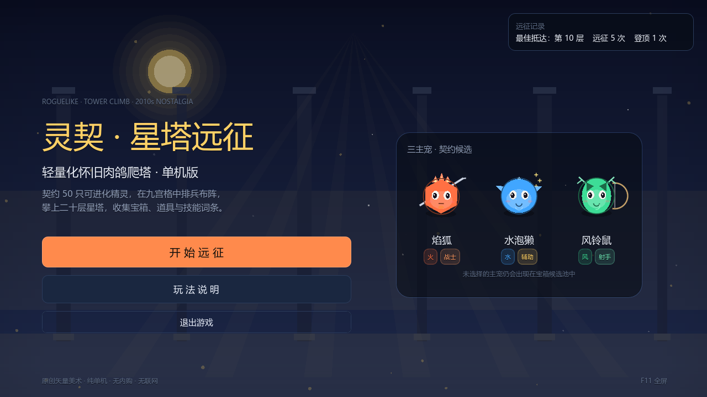
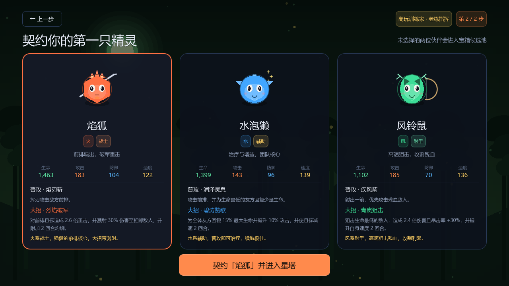
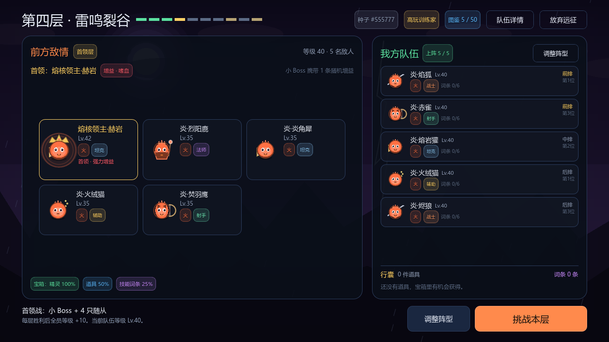
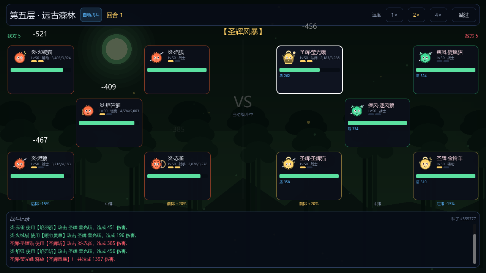
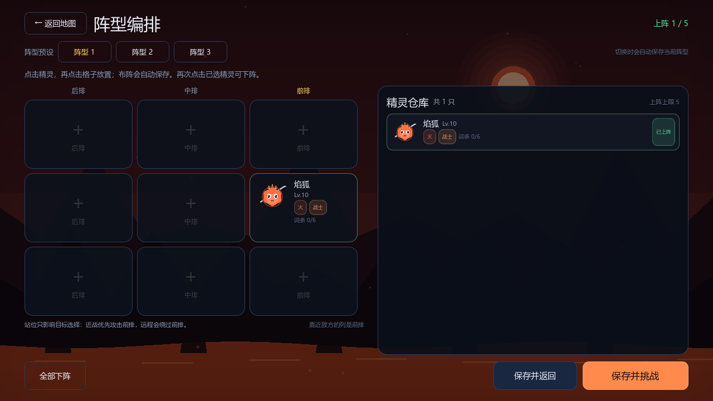
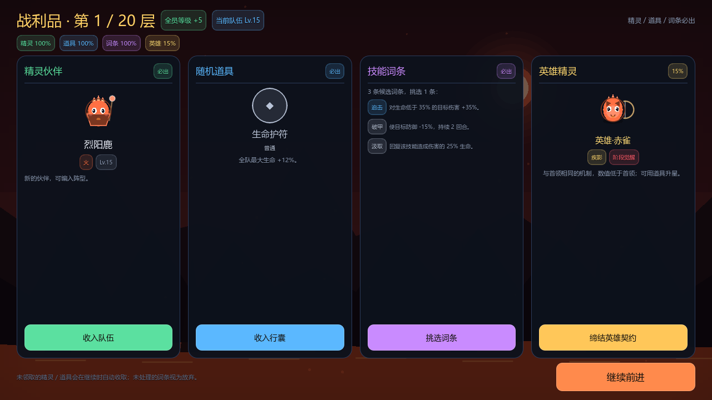
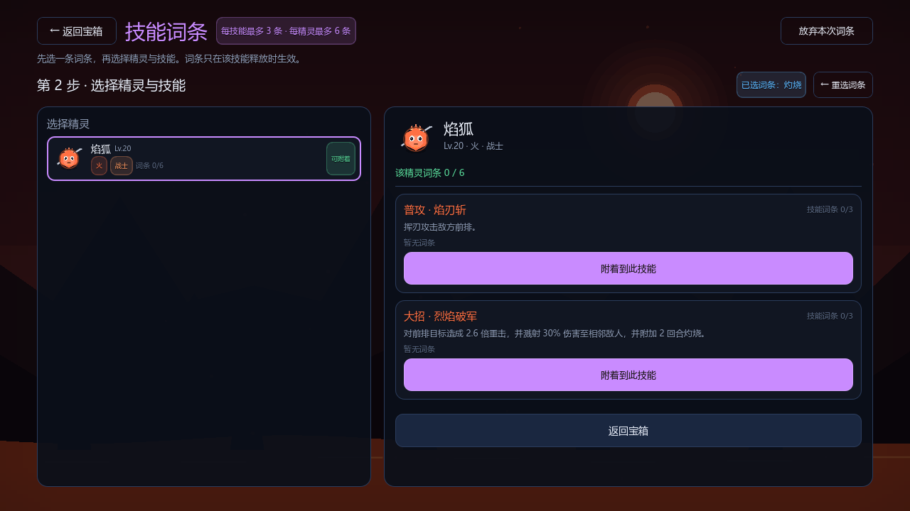

# 灵契·星塔远征

轻量化怀旧肉鸽爬塔单机版，使用 **Godot 4.7 + GDScript** 制作。

> 这是一个对 2010 年代「精灵收集 + 九宫格自动战斗 + 爬塔」玩法的**机制致敬作品**。
> 项目中的 50 只精灵、训练家、首领、技能、词条、道具、名称与全部矢量美术均为原创；
> 不包含、不复制任何第三方游戏的素材、文本或数据文件。









---

## 快速开始

```bat
run_game.bat
```

默认使用 `D:\Claude_test\godot_4.7.2\Godot_v4.7.2-stable_win64.exe`。
如果 Godot 安装位置不同，修改 `run_game.bat` 里的 `GODOT` 变量即可。

也可以在项目目录执行：

```bat
"D:\Claude_test\godot_4.7.2\Godot_v4.7.2-stable_win64.exe" --path .
```

- 分辨率：1280 × 720，可缩放窗口，自动保持比例。
- `F11`：全屏切换。
- 全程鼠标操作；战斗自动进行，默认 0.5×，可切换 0.5× / 1× / 2× / 4× 或跳过。

---

## 单局闭环

```
标题 → 训练家三选一 → 主宠三选一 → 第 1 层
	 → 九宫格布阵 → 自动战斗 → 全员 +10 级
	 → 宝箱三次独立判定（精灵 / 道具 / 词条）
	 → 下一层（新地图）…… → 第 10 层首领 → 登顶结算
```

- 十层地图依次为：熔岩峡谷、幽蓝深海、天空浮岛、雷鸣裂谷（首领）、远古森林、荒芜沙海、星辉圣殿、永夜回廊（首领）、虚空裂隙、星蚀王座（大首领）。
- 第 4、8 层为小 Boss 层，第 10 层为大 Boss 层；Boss 均带 4 只随从。
- 失败或放弃即结束本局；最佳层数、远征次数、登顶次数写入 `user://startower_record.json`。

---

## 核心系统

### 精灵与进化

- 50 只原创精灵，覆盖火 / 水 / 风 / 土 / 光 / 暗六属性与坦克 / 战士 / 法师 / 射手 / 辅助五职业。
- 每只精灵有 3 段形态，在 **30 级、60 级**自动进化，名称、体型标记与属性倍率同步提升。
- 开局只有 1 只主宠；每层宝箱 100% 获得一只本层池内未拥有的精灵，最多上阵 5 只，仓库不限。
- 重复精灵转化为**共鸣**：该精灵全属性永久 +8%（可叠加，受「共鸣水晶」道具增强）。

### 九宫格与阵型

- 3 × 3 自由摆放，最多 5 只，**只由玩家手动布阵**；不再提供自动布阵。
- 站位只影响目标选择（坦克/战士优先前排、法师优先后排、射手打残血），**不改变伤害**。
- 布阵会立即写入本局状态，并在后续楼层沿用；支持 **3 套阵型预设**，切换时自动保存当前摆放。
- 新获得的精灵不会自动上阵，需要玩家自行替换/补位。
- 敌方阵型由模板生成，按本层精灵池、职业权重与等级公式随机；不会复制玩家阵容。

### 自动战斗

- 按速度决定行动顺序，职业决定目标偏好：
  - 坦克 / 战士：前排；法师：后排；射手：生命最低；辅助：攻击前排并治疗最弱友方。
- **气势**：普攻 +1、受击 +1，上限 2 点；达到 2 点时下一次行动释放大招并清空气势。
- 属性克制：克制 125% 伤害，被克制 80%；光暗互克。
- 状态：灼烧、眩晕、减速、急速、攻击提升/降低、破甲、易伤、反伤、吸血。
- 首领：小 Boss 随机 1 条增益，大 Boss 随机 2 条；大 Boss 在 70% / 40% 生命时进入更强阶段。
- 战斗默认 **0.5× 速度**，可切换 0.5 / 1 / 2 / 4 倍；跳过会直接结算。
- 战斗表现：近战突进与斩击、远程弹道、大招充能/爆发、受击火花、治疗与护盾特效。
- 伤害数字分级：普通白色、**暴击**金色大字、**克制**橙色、**弱效**蓝色，并带有描边与浮字动画。
- 数值调整：战士大招 2.15×（溅射 25%），射手大招 2.0×（暴击 +25%），坦克大招护盾 12% 最大生命、普攻附带 3% 护盾。

### 宝箱：三次独立判定

| 奖励 | 概率 | 规则 |
|---|---:|---|
| 本层精灵 | 100% | 从本层精灵池随机未拥有精灵；全拥有时转共鸣 |
| 随机道具 | 50% | 按稀有度权重抽取；训练家与「幸运金币」可提升 |
| 技能词条 | 25% | 三选一，再选精灵与技能附着 |

- 每技能最多 3 条词条，每精灵最多 6 条。
- 技能满 3 条时可选择替换；精灵满 6 条时可替换或转化为随机道具。
- 词条分普通 / 稀有 / 史诗，权重 60 / 30 / 10，可在 `Combat` 与 `Affixes` 表调整。

### 训练家 / 道具 / 首领

- 3 名训练家：
  - 新手：全队生命 +12%，开局 1 件随机道具。
  - 高玩：全队攻击 +12%，道具判定 +10%。
  - 大神：全队速度 +12%、暴击 +8%，初始精灵自带 1 条随机词条。
- 20 件道具，覆盖属性、吸血、反伤、每回合回复、死亡保护、Boss 增伤、普攻追加、灼烧/减速等。
- 3 名首领：熔核领主·赫岩、幽夜女巫·瑟琳、星蚀龙皇·奥瑞恩；10 条随机首领增益。

---

## 数据与表格导入

运行时只读取 `data/content.json`；`data/StarTower_Content.xlsx` 是可编辑源表。

```bat
:: 由 Python 源数据重新生成 JSON + XLSX
python tools/build_content.py

:: 编辑 XLSX 后，校验并重新生成 content.json
python tools/import_content.py
```

也可以双击 `import_content.bat`。

### 表格页

| Sheet | 内容 |
|---|---|
| `Elements` | 六属性、颜色、克制 / 被克 / 互克关系 |
| `Classes` | 五职业基础数值、定位、普攻目标 |
| `Trainers` | 训练家增益与开局特权 |
| `Starters` | 三主宠名单与介绍 |
| `Pets_50` | 50 精灵的 3 段名称、属性、职业、基础数值、技能引用 |
| `Skills` | 精灵 / Boss 的普攻与大招：名称、类型、目标、倍率、描述 |
| `Affixes` | 词条名称、稀有度、效果数值 |
| `Items` | 道具名称、稀有度、效果、触发 hook |
| `Bosses` | 首领属性倍率、增益数量、阶段规则、技能引用 |
| `Boss_Buffs` | 首领随机增益池 |
| `Maps` | 十层场景配色与风格 |
| `Floors` | 层数、敌人数量、等级、精灵池、Boss、随从数量与倍率 |
| `Formation` | 玩家 / 敌人 / Boss 阵型模板（站位不再提供伤害修正） |
| `Combat` | 等级成长、进化阈值、战斗常数、宝箱概率、词条上限 |
| `Import_Report` | 导入校验结果（自动刷新） |

### 导入校验

`tools/import_content.py` 会检查：

- 50 精灵、3 主宠、3 训练家、18 词条、20 道具、3 首领、10 层；
- 所有层池、Boss、地图、阵型模板、技能引用均无悬空；
- 精灵拥有 3 段非空名称与完整普攻 / 大招；
- 词条稀有度存在对应权重；
- 全表不包含 `mirror` 或 `highestStat` 小怪规则。

校验失败时**不会**覆盖 `content.json`，并把错误写入 `Import_Report`。

---

## 测试与验证

```bat
run_tests.bat
```

等价于：

```bat
Godot --headless --path . -- --test
```

测试内容：

1. 数据完整性与引用完整性；
2. 全部 UI / 核心脚本可编译加载；
3. 词条上限、替换、重复拦截；
4. 宝箱概率统计（4000 次判定）；
5. 1–10 层敌人数量、Boss 与随从、层池来源；
6. 96 次完整远征模拟，输出每层胜率、完整通关率、平均战斗回合数；
7. 战斗事件流、生命 / 气势不变量；
8. 无头 UI 流程测试：标题 → 训练家 → 主宠 → 手动布阵 → 战斗 → 宝箱 → 下一层 → 阵型预设。
9. 第 8 层 5v5 压力场景的帧率采样与战斗模拟耗时输出。

> 模拟使用确定性种子，结果可复现。平衡数值改动后可直接重跑。

### 性能优化

- 战斗飘字、弹道、斩击、爆发、受击特效统一由一个 Canvas 节点绘制；不再为每次伤害创建 Label 和 Tween。
- 战斗单位卡的样式盒、文字、气势与状态只在变化时更新，避免长战斗中反复分配。
- 背景动画降至 15 FPS，并减少夜间/虚空场景的粒子数量。
- “跳过”时关闭视觉特效与日志刷新，只同步最终状态。
- 第 8 层 5v5 压力场景实测：战斗模拟约 9 ms / 246 个事件，画面稳定在 137–144 FPS。

### 当前平衡（96 次完整远征模拟，自动贪心策略）

| 层 | 1 | 2 | 3 | 4 小Boss | 5 | 6 | 7 | 8 小Boss | 9 | 10 大Boss |
|---|---:|---:|---:|---:|---:|---:|---:|---:|---:|---:|
| 到达 | 96 | 78 | 71 | 53 | 36 | 27 | 24 | 19 | 16 | 14 |
| 胜率 | 81% | 91% | 75% | 68% | 75% | 89% | 79% | 84% | 88% | 64% |

- 完整通关：9 / 96（9.4%）。
- 平均战斗回合：约 22 回合。
- 模拟策略不会手动调整阵型，也不会为词条挑选最优精灵；真人玩家通常能取得更高通关率。
- 前三层有轻度新手宽恕（敌方属性 80% / 90%），中后期逐步回到 100% 以上。

视觉冒烟测试（会短暂打开窗口并截图到 `shots/`）：

```bat
"<Godot 路径>" --path . -- --shots
```

---

## 目录结构

```
project.godot
scenes/Main.tscn
scripts/
  main.gd                 场景路由与淡入淡出
  autoload/
	content_db.gd         数据加载、索引、抽卡/抽词条
	game_state.gd         单局状态、敌人生成、奖励、等级与进化
	ui.gd                 主题、颜色、控件工厂
  core/
	battle_engine.gd      纯逻辑自动战斗（事件流）
  ui/
	pet_avatar.gd         程序化精灵立绘
	backdrop.gd           程序化动态场景
	unit_card.gd          战斗单位卡
	title/trainer/starter/map/formation/battle/reward/affix/result_screen.gd
data/
  content.json            运行时数据
  StarTower_Content.xlsx  可编辑源表
tools/
  content_source.py       规范数据源
  build_content.py        JSON + XLSX 生成
  import_content.py       XLSX 校验与导入
tests/
  test_runner.gd          无头回归 / 平衡模拟
  shot_runner.gd          截图冒烟测试
```

---

## 验收对照

- 10 层可通关，第 1–9 层普通 / 首领战，第 10 层大 Boss。
- 3 训练家、3 主宠、50 精灵、18 词条、20 道具、2 小 Boss + 1 大 Boss。
- 前四层敌人数量依次为 1 / 2 / 3 / Boss + 4；后续为 5 人阵。
- 宝箱三次独立判定；词条附着、上限、替换 / 转化均已实现。
- 阵型只由玩家手动布置并自动保存，跨层沿用；前后排不再提供伤害加成。
- 初始战斗速度 0.5×；普攻、大招、受击均有独立特效；伤害数字区分普通 / 暴击 / 克制 / 弱效。
- 战士大招 2.15×、射手大招 2.0×、坦克大招护盾 12% 最大生命。
- 敌人只从 `Floors.pool` 生成，不复制玩家阵容，不使用最高数值精灵素材。
- XLSX 修改后可重新导入 `content.json`，导入器负责悬空引用检查。
- 代码与数据中不存在 `mirror` / `highestStat` 规则。

## 已知取舍

- 无外部音频与图片素材，所有精灵和场景为运行时矢量绘制。
- 单局不提供中途存档；退出即结束本局（记录最佳层数）。
- 战斗为纯自动，玩家策略集中在阵容、阵型、宝箱选择与词条搭配。
- 平衡以无头模拟为准；修改数据后可运行测试重新评估胜率。
- 十层地图在内容表中逐层指定并保证互不重复，而不是每局重新随机；这样能保持「熔岩 → 深海 → 天空 → 首领」的主题推进。若需要每局随机地图，可在 `GameState.start_run()` 中按地图池重排后覆盖 `Floors.map`。
- 第 4 层同时命中原计划的「前四层上阵 1/2/3/4 只」与「Boss 战带 4 只小怪」两条规则。本项目按 Boss 规则实现为 Boss + 4 随从（共 5 个单位），第 8、10 层同理。
- 项目没有附带 Windows 导出模板（约 1 GB），因此通过已安装的 Godot 4.7 二进制运行；如需独立 exe，可在 Godot 中安装导出模板后使用标准 Windows 导出。
