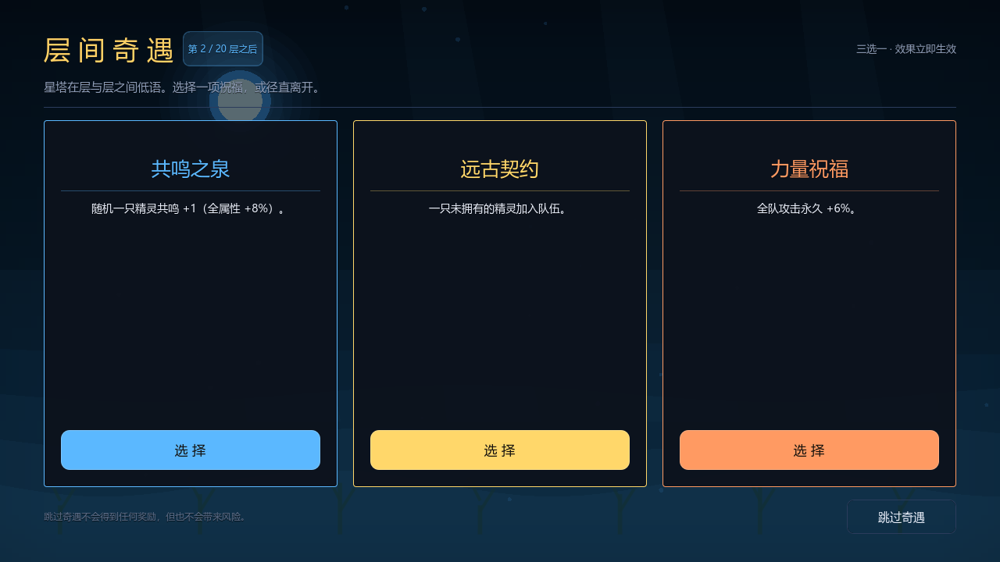

# 灵契·星塔远征

轻量化怀旧肉鸽爬塔单机版，使用 **Godot 4.7 + GDScript** 制作。

> 这是一个对 2010 年代「精灵收集 + 九宫格自动战斗 + 爬塔」玩法的**机制致敬作品**。
> 项目中的 50 只精灵、训练家、首领、技能、词条、道具、名称与全部矢量美术均为原创；
> 不包含、不复制任何第三方游戏的素材、文本或数据文件。




---

## 快速开始

```bat
run_game.bat
```

Windows 默认使用 `D:\Claude_test\godot_4.7.2\Godot_v4.7.2-stable_win64.exe`。
如果 Godot 安装位置不同，修改 `run_game.bat` 里的 `GODOT` 变量即可。

macOS 使用项目内的 Godot 4.7.2：

```bash
./run_game.sh
```

也可以在项目目录执行：

```bat
"D:\Claude_test\godot_4.7.2\Godot_v4.7.2-stable_win64.exe" --path .
```

- 分辨率：1280 × 720，可缩放窗口，自动保持比例。
- `F11`：全屏切换。
- 全程鼠标操作；战斗自动进行，默认 0.5×，可切换 0.5× / 1× / 2× / 4× 或跳过。

---

## 单局闭环

```
标题 → 训练家三选一 → 主宠三选一 → 第 1 层
	 → 九宫格布阵 → 自动战斗 → 全员 +5 级
	 → 宝箱：精灵 / 道具 / 词条必出，精灵按稀有度抽取（英雄 5%）
	 → 部分楼层触发层间奇遇（三选一）
	 → 下一层（新地图）…… → 第 40 层终焉魔王 → 登顶结算
```

- 四十层，每 10 层一个世代。第 5 / 15 / 25 / 35 层是原来的四名首领；第 10 / 20 / 30 / 40 层是四代魔王，都带 4 只随从。
- 魔王开场有无敌屏障。英雄或魔人打中一次后屏障破碎，这一下不造成伤害，之后任何攻击都能打中。
- 第一个魔王之前，如果还没有英雄或魔人，奇遇必出免费的「世代契约」。没带上能破屏障的精灵就打不穿。
- 击败魔王必定契约该世代的新魔人。魔人不会出现在宝箱里。
- 第 2 / 5 / 8 / 11 / 14 / 17 / 20 / 23 / 26 / 29 / 32 / 35 / 38 层通关后有层间奇遇。
- 失败或放弃即结束本局；最佳层数、远征次数、登顶次数写入 `user://startower_record.json`。

---

## 核心系统

### 精灵与进化

- 50 只原创精灵，覆盖一般 / 火 / 水 / 电 / 草 / 冰 / 格斗 / 毒 / 地面 / 飞行 / 超能 / 虫 / 岩石 / 幽灵 / 龙 / 恶 / 钢，共十七系（无妖精），以及坦克 / 战士 / 法师 / 射手 / 辅助五职业。
- 稀有度：普通 18、稀有 14、史诗 9、传说 6、英雄 3。稀有及以上有专属印记和大招效果；普通精灵保持简单剪影。
- 每只精灵有 3 段形态，在 **30 级、60 级**自动进化；等级上限 120。
- 开局三主宠为焰狐（火）/ 水泡獭（水）/ 蒲公英兔（草）。宝箱按稀有度从全图鉴抽取，不是本层池。
- 重复精灵转化为**共鸣**：该精灵全属性永久 +8%（可叠加，受「共鸣水晶」道具增强）。

### 九宫格与阵型

- 3 × 3 自由摆放，最多 5 只，**只由玩家手动布阵**；不再提供自动布阵。
- 站位影响目标选择。存活的坦克会嘲讽敌方单体攻击；同排、站在坦克身后的单位有 30% 伤害由坦克承担。
- 上下左右相邻的职业会触发连携（例如坦克+射手减伤、法师+辅助强化治疗）。
- 布阵可以拖拽上阵、交换，也可以点选后再点格子。仓库里的「详情」能看属性、普攻、大招、印记和词条。
- 布阵会立即写入本局状态，并在后续楼层沿用；支持 **3 套阵型预设**，切换时自动保存当前摆放。
- 新获得的精灵不会自动上阵，需要玩家自行替换/补位。
- 敌方阵型由模板生成，按本层精灵池、职业权重与等级公式随机；不会复制玩家阵容。

### 元素共鸣

- 上阵同元素 2 只激活一阶、3 只激活二阶团队加成，可同时激活多个元素。
- 加成覆盖生命 / 攻击 / 防御 / 速度 / 暴击，数值来自 `Resonance` 表。
- 编队界面会实时提示「还需几只」与当前生效的加成；队伍面板与地图也会展示已激活共鸣。

### 自动战斗

- 按速度决定行动顺序，职业决定目标偏好：
  - 坦克 / 战士：前排；法师：后排；射手：生命最低；辅助：攻击前排并治疗最弱友方。
- **气势**：普攻 +1、受击 +1，上限 2 点；达到 2 点时下一次行动释放大招并清空气势。气势满时单位卡会亮起金色边框。
- 属性克制按标准十七系表：克制 2 倍，被克制 0.5 倍，无效为 0 伤害。本系技能额外 +20%。
- 状态：灼烧、眩晕、减速、急速、攻击提升/降低、破甲、易伤、反伤、吸血。
- 战斗默认 **0.5× 速度**，可切换 0.5 / 1 / 2 / 4 倍；跳过会直接结算。
- **大招演出**：释放时依次出现符阵、光柱、元素专属打击（陨火 / 潮汐 / 旋风 / 地刺 / 圣光 / 暗涡 / 雷击）、冲击波与震屏；英雄精灵额外叠加金色圣光。演出期间仅使用一个 Canvas 节点绘制，不创建临时节点。
- 伤害数字分级：普通白色、**暴击**金色大字、**克制**橙色、**弱效**蓝色，并带有描边与浮字动画。

### 首领

- 4 名旧首领留在第 5 / 15 / 25 / 35 层：熔核领主·赫岩、幽夜女巫·瑟琳、雷霆巨像·罡岳、星蚀龙皇·奥瑞恩。
- 4 名魔王在第 10 / 20 / 30 / 40 层：赤潮魔王·焚渊、霜狱魔王·溟雪、蚀月魔王·夜冕、终焉魔王·星陨。终焉魔王比旧的最终首领更强。
- 旧首领随机 2 到 3 条增益，最终魔王随机 4 条；增益来自 13 条首领增益池：
  狂怒、不屈、磐岩、迅捷、嗜血、尖刺、再生、威压、护佑、过载、**破防**、**狂怒（低血增伤）**、**虹吸**。
- 所有首领都有**阶段机制**：血量阈值时回满气势、获得 12% 最大生命护盾并强化；最终首领拥有 3 个阶段。
- 首领普攻附带元素效果（灼烧 / 减速 / 破甲 / 易伤 / 护盾等），大招为多目标元素爆发。
- 随从从当前层精灵池生成，随层数提升属性并携带技能词条。

### 宝箱：关键奖励必出

| 奖励 | 概率 | 规则 |
|---|---:|---|
| 精灵 | 100% | 先抽稀有度：普通 45 / 稀有 25 / 史诗 15 / 传说 10 / 英雄 5，再抽该档未拥有的精灵；该档抽空则向下顺延，全拥有时转共鸣。不出首领，不出魔人 |
| 随机道具 | 100% | 按稀有度权重抽取；已达堆叠上限的道具不再出现 |
| 技能词条 | 100% | 三选一，再选精灵与技能附着 |

- 每个技能最多 3 条词条，每精灵最多 6 条。
- 技能满 3 条时可选择替换；精灵满 6 条时可替换或转化为随机道具。
- 词条分普通 / 稀有 / 史诗，权重 60 / 30 / 10，可在 `Combat` 与 `Affixes` 表调整。
- 道具堆叠上限来自 `Items.max_stack`：例如「战意项链」最多持有 2 个，达到上限后不会再被抽到。

### 英雄精灵

- 英雄是 5% 稀有度，不是额外开箱。获得英雄种时自动进入阶段觉醒，并带 1 条首领增益。
- 英雄种自身倍率 1.50，魔人 1.65；不再叠乘旧的英雄属性倍率。星级 0–3 仍然生效。
- 独立星级 0–3，每星全属性 +6%，升星消耗 1 件道具；在「队伍详情」中操作。
- 英雄不参与普通精灵共鸣，可重复获得；名字带「英雄·」前缀与金色边框。

### 层间奇遇与精英试炼

- 第 2 / 5 / 8 / 11 / 14 / 17 层通关后，从奇遇池随机抽取 3 个选项：
  - **星辉宝库**：2 件随机道具；**远古遗物**：1 件高品质道具。
  - **四类祝福**：全队生命 / 攻击 / 防御 / 速度永久提升。
  - **共鸣之泉**：随机精灵共鸣 +1。
  - **远古契约**：一只未拥有的精灵加入队伍。
  - **试炼之门**：下一层变为精英试炼，敌人全属性 ×1.25，胜利额外获得道具。
  - **献祭祭坛**：失去 1 件最弱道具，换取随机精灵共鸣 +2。
  - **英雄熔炉**：随机英雄精灵免费升 1 星。
- 奇遇可跳过；所有效果立即生效并写入本局状态。

### 训练家 / 道具

- 3 名训练家。选中的主宠没有等级上限，技能词条可以一直叠加，同一条也能叠多层。
  - 新手：没有属性加成。主宠普攻带「天命」，2% 概率造成 99999 点伤害。
  - 高级：全队生命、攻击、防御、速度 +10%，开局自选 3 件道具。
  - 老练：全队四项属性 +20%，初始精灵从英雄中选择。
- 20 件道具，覆盖属性、吸血、反伤、每回合回复、死亡保护、Boss 增伤、普攻追加、灼烧/减速等。

---

## 数据与表格导入

运行时只读取 `data/content.json`；`data/StarTower_Content.xlsx` 是可编辑源表。

```bat
:: 由 Python 源数据重新生成 JSON + XLSX
python tools/build_content.py

:: 编辑 XLSX 后，校验并重新生成 content.json
python tools/import_content.py
```

也可以双击 `import_content.bat`。

### 表格页

| Sheet | 内容 |
|---|---|
| `Elements` | 十七系、颜色、克制 / 抵抗 / 无效 |
| `Classes` | 五职业基础数值、定位、普攻目标 |
| `Trainers` | 训练家增益与开局特权 |
| `Starters` | 三主宠名单与介绍 |
| `Pets_50` | 50 精灵的 3 段名称、属性、职业、基础数值、技能引用 |
| `Skills` | 精灵 / Boss 的普攻与大招：名称、类型、目标、倍率、描述 |
| `Affixes` | 词条名称、稀有度、效果数值 |
| `Items` | 道具名称、稀有度、效果、触发 hook、`max_stack` |
| `Bosses` | 首领属性倍率、增益数量、阶段规则、技能引用 |
| `Boss_Buffs` | 首领随机增益池 |
| `Maps` | 二十层场景配色与风格 |
| `Floors` | 层数、敌人数量、等级、精灵池、Boss、随从数量与倍率、敌方词条数 |
| `Resonance` | 六元素共鸣阈值与团队属性加成 |
| `Formation` | 玩家 / 敌人 / Boss 阵型模板（站位不再提供伤害修正） |
| `Combat` | 等级成长、进化阈值、战斗常数、宝箱概率、英雄参数、词条上限 |
| `Import_Report` | 导入校验结果（自动刷新） |

### 导入校验

`tools/import_content.py` 会检查：

- 50 精灵、3 主宠、3 训练家、19 词条、20 道具、4 首领、20 层；
- 所有层池、Boss、地图、阵型模板、技能引用均无悬空；
- 精灵拥有 3 段非空名称与完整普攻 / 大招；
- 词条稀有度存在对应权重；
- 六元素均配置共鸣，且只使用允许的属性键；
- 道具 `max_stack`、楼层 `minion_affix_count` 合法；
- 全表不包含 `mirror` 或 `highestStat` 小怪规则。

校验失败时**不会**覆盖 `content.json`，并把错误写入 `Import_Report`。

---

## 测试与验证

```bat
run_tests.bat
```

等价于：

```bat
Godot --headless --path . -- --test
```

测试内容：

1. 数据完整性与引用完整性（含 20 层 / 4 首领 / 共鸣 / 英雄参数）；
2. 全部 UI / 核心脚本可编译加载；
3. 词条上限、替换、重复拦截；
4. 宝箱概率统计（2000 次判定：精灵 / 道具 / 词条 100%，英雄种约 5%，无独立英雄卡）；
5. 道具堆叠上限（战意项链 2 个，达上限后不再掉落）；
6. 元素共鸣阈值与团队加成；
7. 1–20 层敌人数量、Boss 阶段、随从词条成长；
8. 层间奇遇三选一与结算；
9. 精英试炼属性倍率与额外奖励；
10. 英雄精灵属性、命名、升星消耗与阶段；
11. 48 次完整 20 层远征模拟，输出每层胜率、完整通关率、平均战斗回合数；
12. 战斗事件流、生命 / 气势不变量；
13. 无头 UI 流程测试：标题 → 训练家 → 主宠 → 手动布阵 → 战斗 → 宝箱 → 下一层 → 阵型预设。

> 模拟使用确定性种子，结果可复现。平衡数值改动后可直接重跑。

### 平衡基准（48 次完整远征模拟，自动贪心策略）

| 层 | 到达 | 胜率 | 层 | 到达 | 胜率 |
|---|---:|---:|---|---:|---:|
| 1 | 48 | 72.9% | 11 | 11 | 100% |
| 2 | 35 | 91.4% | 12 | 11 | 81.8% |
| 3 | 32 | 84.4% | 13 | 9 | 100% |
| 4 | 27 | 96.3% | 14 | 9 | 44.4% |
| 5 首领 | 26 | 88.5% | 15 首领 | 4 | 100% |
| 6 | 23 | 95.7% | 16 | 4 | 50.0% |
| 7 | 22 | 86.4% | 17 | 2 | 100% |
| 8 | 19 | 94.7% | 18 | 2 | 100% |
| 9 | 18 | 88.9% | 19 | 2 | 100% |
| 10 首领 | 16 | 68.8% | 20 首领 | 2 | 100% |

- 完整通关：2 / 48（4.2%）。
- 平均战斗回合：约 22 回合。
- 模拟策略不会手动调整阵型，不会为词条挑选最优精灵，也不会使用英雄升星；真人玩家通常能取得更高通关率。
- 第 1–3 层保留新手宽恕（敌方属性 86% / 88% / 91%），随后逐层回到 100% 以上。

### 性能优化

- 战斗飘字、弹道、斩击、爆发、受击与元素大招特效统一由一个 Canvas 节点绘制；不再为每次伤害创建 Label 和 Tween。
- 战斗单位卡的样式盒、文字、气势与状态只在变化时更新，避免长战斗中反复分配。
- 背景动画降至 15 FPS，并减少夜间/虚空场景的粒子数量。
- “跳过”时关闭视觉特效与日志刷新，只同步最终状态。
- 第 14 层 5v5 压力场景实测：画面稳定在 139–144 FPS。

视觉冒烟测试（会短暂打开窗口并截图到 `shots/`）：

```bat
"<Godot 路径>" --path . -- --shots
```

---

## 目录结构

```
project.godot
scenes/Main.tscn
scripts/
  main.gd                 场景路由与淡入淡出
  autoload/
	content_db.gd         数据加载、索引、抽卡/抽词条/共鸣
	game_state.gd         单局状态、敌人生成、奖励、等级、奇遇、英雄
	ui.gd                 主题、颜色、控件工厂
  core/
	battle_engine.gd      纯逻辑自动战斗（事件流）
  ui/
	pet_avatar.gd         程序化精灵立绘
	backdrop.gd           程序化动态场景
	unit_card.gd          战斗单位卡
	battle_fx.gd          Canvas 战斗特效与大招演出
	title/trainer/starter/map/formation/battle/reward/affix/event/result_screen.gd
data/
  content.json            运行时数据
  StarTower_Content.xlsx  可编辑源表
tools/
  content_source.py       规范数据源
  build_content.py        JSON + XLSX 生成
  import_content.py       XLSX 校验与导入
tests/
  test_runner.gd          无头回归 / 平衡模拟
  shot_runner.gd          截图冒烟测试
```

---

## 验收对照

- 20 层可通关，第 5 / 10 / 15 层小 Boss，第 20 层大 Boss。
- 3 训练家、3 主宠（火/水/草）、50 精灵、19 词条、20 道具、4 首领、4 魔人、17 系共鸣。
- 前四层敌人数量依次为 1 / 2 / 3 / 4；后续为 5 人阵；Boss 层为 Boss + 4 随从。
- 宝箱精灵 / 道具 / 词条必出；英雄是 5% 稀有度，没有独立英雄卡。道具堆叠上限生效。
- 英雄种与魔人具备阶段觉醒、独立星级与升星消耗。
- 元素共鸣 2 / 3 只激活两档团队加成。
- 层间奇遇三选一，精英试炼会强化下一层并额外掉落。
- 阵型只由玩家手动布置并自动保存。坦克嘲讽、守护与相邻连携生效；前后排不再提供固定伤害加减。
- 初始战斗速度 0.5×；普攻、大招、受击均有独立特效；大招有符阵 / 元素打击 / 震屏演出。
- 敌人只从 `Floors.pool` 生成，不复制玩家阵容，不使用最高数值精灵素材。
- XLSX 修改后可重新导入 `content.json`，导入器负责悬空引用检查。
- 代码与数据中不存在 `mirror` / `highestStat` 规则。

## 已知取舍

- 无外部音频与图片素材，所有精灵和场景为运行时矢量绘制。
- 进行中的一局会自动保存。回到标题可「继续远征」；打完或战败后只保留最佳层数。战斗播放中途退出会回到地图，再打一次。
- 战斗为纯自动，玩家策略集中在阵容、阵型、宝箱选择、奇遇与词条搭配。
- 平衡以无头模拟为准；修改数据后可运行测试重新评估胜率。
- 二十层地图在内容表中逐层指定并保证互不重复，而不是每局重新随机；这样能保持主题推进。若需要每局随机地图，可在 `GameState.start_run()` 中按地图池重排后覆盖 `Floors.map`。
- 英雄精灵是普通精灵的变体，不单独占用图鉴，也不参与普通共鸣。
- 项目没有附带 Windows 导出模板（约 1 GB），因此通过已安装的 Godot 4.7 二进制运行；如需独立 exe，可在 Godot 中安装导出模板后使用标准 Windows 导出。
